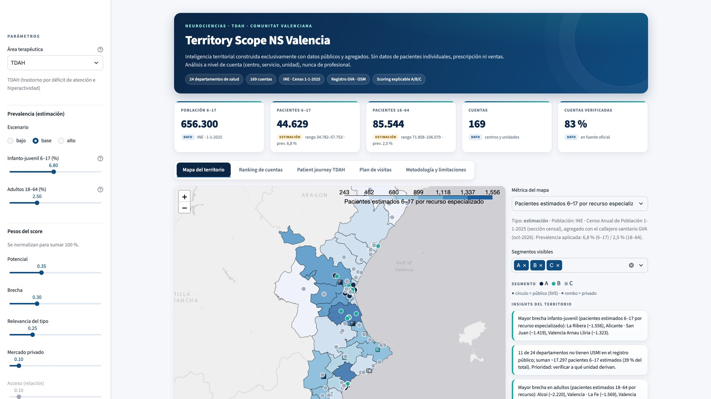
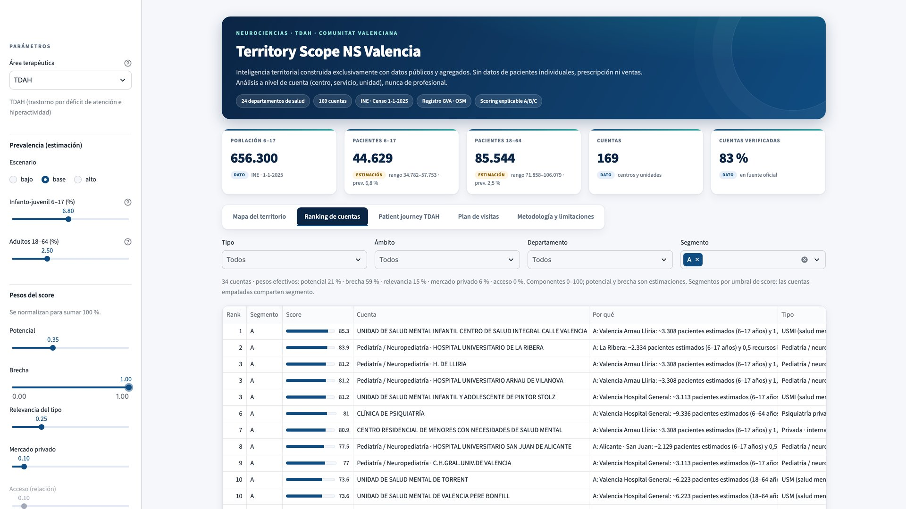
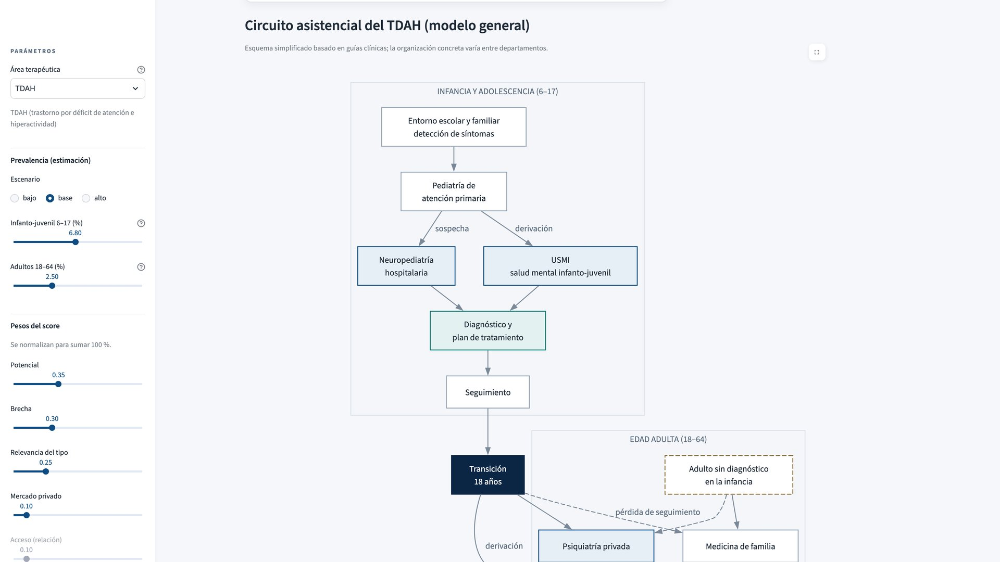
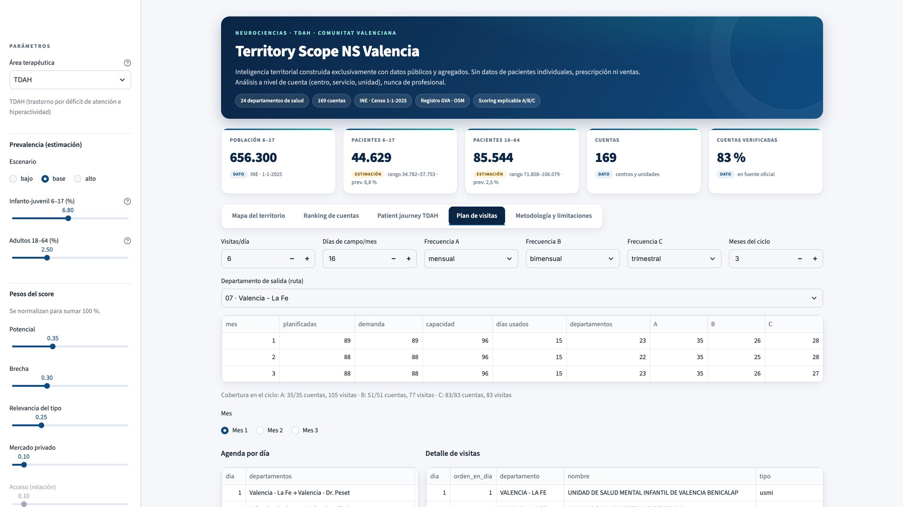

# Territory Scope NS Valencia

**Territory intelligence for ADHD care in the Valencian Community, built on public data only.**
A Streamlit app that estimates where the ADHD diagnostic gap is largest across the 24 health
departments, maps the care network, and turns it into an explainable A/B/C account ranking and a
monthly visit plan.


▶ Full 41-second walkthrough: [`docs/territory-scope-promo.mp4`](docs/territory-scope-promo.mp4)

> The interface is in Spanish (it is built for a Spanish territory); this README is in English.

---

## Problem

ADHD care in the Valencian Community is fragmented across 24 health departments, child and adult
mental-health units (USMI / USM), hospital paediatrics/neuropaediatrics and a growing private
psychiatry market. A new Key Account Manager does not know where the potential is, where the
diagnostic pathway stalls, or how to split visit time across the territory.

## Solution

A territory map built **only from public, aggregated data** that:

1. **Estimates potential patients** per health department (population × published prevalence),
   always shown as a low / base / high range and labelled as an *estimate*.
2. **Maps the care resources** (169 accounts: public hospitals, USMI, USM, day hospitals,
   neuropaediatrics, private psychiatry) with source, date and verification status.
3. **Measures the gap**: estimated patients per specialised resource in each department.
4. **Prioritises accounts A/B/C** with a transparent, weight-editable score and a one-sentence
   *why* for every account.
5. **Builds a visit plan** grouped by department to reduce travel time.

| Map of the territory | Account ranking |
|---|---|
|  |  |

| ADHD patient journey | Visit plan |
|---|---|
|  |  |

## How it works

| Tab | What it shows |
|---|---|
| **Mapa del territorio** | Choropleth of the 24 departments (population, estimated patients, patients per resource), account markers by segment (circle = public, diamond = private) and three automatic insights. |
| **Ranking de cuentas** | Filterable table with score, the five components and the *why* sentence. CSV export. |
| **Patient journey TDAH** | Care pathway from primary care to adult services, the age-18 transition, and three friction points, each with a verified reference. |
| **Plan de visitas** | Visits/day, field days/month and frequency per segment → a monthly cycle routed by neighbouring departments. CSV export. |
| **Metodología y limitaciones** | Sources with URL and date, what is data vs. estimate, assumptions, validation and limitations. |

Key numbers (base scenario, INE population at 1 Jan 2025):

| | Value |
|---|---|
| Population 6–17 | 656,300 (data) |
| Estimated ADHD patients 6–17 | 44,629 (range 34,782–57,753) |
| Estimated ADHD patients 18–64 | 85,544 (range 71,858–106,079) |
| Accounts / verified in an official source | 169 / 83 % |

## Data sources

All downloads are reproducible from `scripts/` and logged with URL, date and SHA-256 in
[`data/raw/SOURCES.json`](data/raw/SOURCES.json).

| Layer | Source |
|---|---|
| Health departments (geometry) | Generalitat Valenciana open data — *Capa de departamentos de salud* (Oct 2026), CC BY 4.0 |
| Census section → department | GVA *Mapa sanitario* street index (adult and paediatric department per census section) |
| Population by age | INE — *Censo Anual de Población*, population by census section and 5-year age group (1 Jan 2025) |
| Public hospitals | GVA — *Sistema Valenciano de Salud: Hospitales* (WFS, ICV) |
| Mental-health units and private centres | GVA — *Registro de centros, servicios y establecimientos sanitarios* (2021, latest published) |
| Private psychiatry (complement) | OpenStreetMap via Overpass (ODbL), marked as not verified |
| Geocoding | CartoCiudad (IGN); precision stored per account |

**Population is aggregated by census section, not by municipality**, because València, Alacant,
Elx, Orihuela, Xirivella and Mislata are split across several departments. The 24 departments add
up exactly to the INE total (5,425,182 inhabitants).

**Prevalence** (editable in [`config/areas/tdah.yaml`](config/areas/tdah.yaml), every figure checked
in PubMed):

| Group | Low | Base | High | Source |
|---|---|---|---|---|
| 6–17 | 5.3 % | 6.8 % | 8.8 % | Polanczyk 2007; Catalá-López 2012 (Spain, 95 % CI 4.9–8.8) |
| 18–64 | 2.1 % | 2.5 % | 3.1 % | Simon 2009 (all adult ages, 95 % CI) |

Fayyad 2017 (WHO WMH surveys, 2.8 %) is cited as context only: it was measured in adults aged
18–44, and prevalence declines with age.

## Scoring model

```
score = Σ weight_i × component_i        (components 0–100, weights normalised to 100 %)
```

| Component | What it measures |
|---|---|
| **Potential** | Estimated patients in the account's department for the age group it serves (scaled within each age group). |
| **Gap** | Estimated patients per specialised resource in that department. Inferred resources count 0.5. |
| **Relevance** | Weight by account type (USMI 100, neuropaediatrics 90, adult USM 80 …), ×0.8 if not verified. |
| **Private market** | 100 if the account is private. |
| **Access** | Existing relationship — only when a private `data/private/relaciones.csv` is present (CRM). Without it the app runs in **demo mode** and this weight is 0. |

Default weights: potential 35 %, gap 30 %, relevance 25 %, private market 10 %. Segments: **A** = top
20 %, **B** = next 30 %, **C** = rest, cut by score threshold so tied accounts share a segment.
Moving the *gap* weight to the maximum, for example, moves La Ribera's neuropaediatrics from #12 to #2.

New therapeutic areas are added with a YAML file in `config/areas/` — no code changes.

## Privacy and compliance rules

- Public and aggregated data only. No patient-level data, no prescription or sales data.
- **No personal data about physicians**: the app works at account level. Private practices named
  after a person, and individual private consultations, are excluded; only counts are kept.
- Product-neutral: no brands, medicines or company logos.
- The optional relationship layer lives in `data/private/`, which is git-ignored.

## Limitations

- Patient numbers are epidemiological estimates, applied uniformly across departments.
- The latest published health-centre registry is from 2021; units opened or closed later are not reflected.
- Many USM/USMI operate inside primary-care centres and are not registered separately: 11
  departments show no USMI in the registry and are flagged for manual verification, not filled in.
- Private supply is under-represented by design (privacy rule above).
- Resource counts do not measure capacity (staff, waiting lists).

## Run it locally

```bash
python -m venv .venv && source .venv/bin/activate
pip install -r requirements.txt
streamlit run app.py
```

Rebuild the data from source:

```bash
python scripts/01_download_phase1.py && python scripts/02_build_population.py
python scripts/03_download_phase2.py && python scripts/04_build_cuentas.py && python scripts/05_pendientes_verificacion.py
```

Tests (population totals, accounts, scoring, visit plan, app smoke test):

```bash
pip install pytest && pytest
```

## Project structure

```
app.py                  Streamlit app (5 tabs)
src/                    load · scoring · insights · visit_plan · content · geo_names
scripts/                reproducible download and processing
config/areas/tdah.yaml  prevalence, weights, resource rules (one file per therapeutic area)
data/processed/         clean CSV / GeoJSON used by the app
tests/                  pytest suite
docs/                   screenshots, demo GIF, promo video, audit report
video/promo/            HyperFrames source of the promo video
```

The promo video's background track comes from the HeyGen music catalog; it is licensed for use in
the video and is not redistributed in this repository (`video/promo/assets/audio/music.mp3` is git-ignored).

## Built with Claude Code

Designed and built in one day by **Dr. Miriam Martínez Santos** with
[Claude Code](https://claude.com/claude-code): data pipeline, scoring model, Streamlit app, a full
audit ([`docs/AUDITORIA.md`](docs/AUDITORIA.md)) and the promo video (HyperFrames).

*Built on public data only. With CRM and sales data, the same model would replace estimates with
real coverage and performance.*
